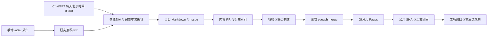

# 内容门户与每日发布架构

Markdown 是唯一正文；Issue 记录当日研究及失败，PR 是归档边界，Pages 是可重建的展示层。

## 正文与接口

一个逻辑日期只对应一个 `docs/daily/YYYY/MM/YYYY-MM-DD.md`。首次论文 marker 不含版本号；后续跨日更新链接原论文并说明新增。schema v1 保留 Asia/Tokyo 与 source_count 的原义；调度和日期决策使用北京时间。portal 是可选兼容元数据，摘要、主题、重点、封面、Issue / PR 全部在原 Markdown 中，详见 [schema](schema.md)。

构建程序解析 GFM、清理 HTML、生成稳定栏目锚点，将历史 H1 栏目降为 H2；全文、目录、论文、工具、主题、搜索均从同一来源生成。外部链接保留，历史内部 Markdown 链接指回 GitHub；远程图片失败显示可读回退。

## 静态门户

Next.js App Router / TypeScript，`output: export`、项目 basePath、trailingSlash 和原生图片。路由为 `/`、`/daily/`、`/daily/YYYY/MM/DD/`、`/papers/`、`/tools/`、`/topics/`、`/topics/[slug]/`、`/search/`。详情和主题预生成，搜索在浏览器读取静态 JSON，支持中文、项目名、论文题名和主题组合筛选，无服务端请求 API。

文章优先参考少数派日报的通栏封面、日期牌、导语、重点导读与完整目录和 680px 阅读栏。桌面显示侧边目录；手机收起完整目录，今日重点作为跳转导读，证据与影响按需展开。移动端头条与紧凑图文列表、平板双栏、浅色 / 暗色 / 系统主题按实际视口验证。封面只接受明确选图元数据，不自动把论文第一张图当日报封面。

## 发布边界

`validate-content.yml` 校验 schema、13 栏编辑完整性、占位、无新增说明、来源、索引、锚点和静态构建。历史 09-18–29 兼容原栏目结构；09-30 起要求原 13 类栏目，真实无新增或检索失败允许简短说明检查范围。

`daily-automerge.yml` 不 checkout 或执行 PR 代码。只处理同仓库可信作者、main 目标、automation/daily 分支及 daily-publish 标签；文件 allowlist 排除网站代码、schema 与工作流。成功 workflow run 的 head 必须等于 PR 当前 head；通过 validate job 后以 SHA 锁定 squash merge，再显式 dispatch Pages。

`pages.yml` 在 main push 或手动 dispatch 构建部署。部署成果带 deployment.json 的 commit、updatedThrough、dailyCount 及逐日报告源文件 SHA256。`record_publication.py` 仅在已合并完整报告、公开部署 SHA、首页 / 详情 HTML 的身份及源文件 hash 一致，并再次确认 main 未变化后更新成功记录；失败保留窗口。详细运行、切换和回退见 [publication.md](publication.md)。

旧 arXiv 定时入口在 ChatGPT 完整发布实测前暂留；采集器仅形成底稿，不能自动标记完整日报。日常编辑使用 ChatGPT，不依赖 OpenAI API Key。Dot 是可选协调入口，不作为权限绕过或每日依赖。

## 资料

- [少数派日报文章](https://sspai.com/post/115197)、[派早报列表](https://sspai.com/tag/%E6%B4%BE%E6%97%A9%E6%8A%A5)
- [Radiance Fields](https://radiancefields.com/)
- [Next.js 静态导出](https://nextjs.org/docs/app/guides/static-exports)
- [GitHub Pages 自定义工作流](https://docs.github.com/en/pages/getting-started-with-github-pages/using-custom-workflows-with-github-pages)
- [GITHUB_TOKEN 触发限制](https://docs.github.com/en/actions/concepts/security/github_token)
